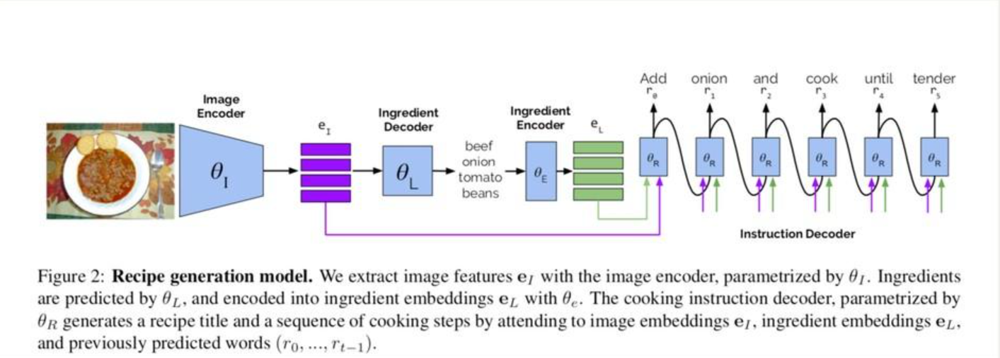

# 张嘉荣调研记录

> 成员历史调研与候选方案记录，正文保留原样，不作为当前实现状态或最终实验协议。agent 请先读根 [AGENTS.md](../../../AGENTS.md)，当前实施设计见[第五章](../../report/sections/technical_plan.tex)。文中外部论文链接与技术陈述需在实际采用时核验。

# 一、方向 C：结构化膳食生成

|**代表研究**|**核心内容**|**对 FoodLens 的参考价值**|
|---|---|---|
|Inverse   Cooking（CVPR 2019）|从食物照片预测食材集合，再生成烹饪步骤。|借鉴“先识别食材、再组织结构化结果”的分阶段思路。|
|Nutrition5k（CVPR   2021）|提供食物图像、重量与营养标注，研究热量及三大营养素估计。|任务二最直接的数值估计与数据设计参考。|
|Qwen3\-VL（2025）|通用视觉语言模型，具备图文理解和结构化文本生成能力。|作为食物图像到 JSON 的候选基础模型。|
|LoRA（ICLR   2022）/ QLoRA（NeurIPS 2023）|低秩参数微调；QLoRA 结合量化降低显存需求。|控制多模态微调的训练成本。|

## C1  Nutrition5k: Towards Automatic Nutritional Understanding of Generic Food

任务二的营养估计参考；任选方向③的重点论文

|**项目**|调研内容|
|---|---|
|**论文**|Nutrition5k: Towards Automatic Nutritional   Understanding of Generic Food（CVPR 2021）|
|**研究问题**|如何从真实餐食图像中估计总重量、热量及蛋白质、脂肪、碳水化合物？|
|**核心方法**|以图像编码器提取视觉特征，直接回归整餐营养值；分别研究每克营养密度、RGB 总营养预测，以及融合深度信息的预测方案。|
|**数据与条件**|Nutrition5k 约 5000 份餐食；提供视频/RGB、深度图、食材组成与重量、营养标签。原论文基线使用   InceptionV2，主指标是 MAE。|
|**方法局限**|单视角 RGB 缺少可靠体积信息；数据采集场景与菜系分布有限，跨场景泛化存在挑战。|
|**对本项目的启发**|任务二需要预测食物重量、热量和营养成分。这篇论文可以帮助我们了解，怎样从图片中估计这些数字，以及怎样检查估计得准不准。|
|**待验证问题**|在课程数据、相同划分和相同输入条件下，独立回归与 JSON 自回归生成哪种 MSE 更低？是否需要联合训练？|

论文链接：https://openaccess\.thecvf\.com/content/CVPR2021/html/Thames\_Nutrition5k\_Towards\_Automatic\_Nutritional\_Understanding\_of\_Generic\_Food\_CVPR\_2021\_paper\.html

## C2  Inverse Cooking: Recipe Generation From Food Images

任务二的食材识别和结构化生成参考

|**项目**|调研内容|
|---|---|
|**论文**|Inverse Cooking: Recipe Generation From Food Images（CVPR   2019）|
|**研究问题**|如何根据成品菜肴图片反推食材集合，并生成相应烹饪步骤？|
|**核心方法**|先将食材预测建模为无序集合生成，再以图片和食材预测共同作为条件生成烹饪步骤。|
|**数据与条件**|在 Recipe1M 食谱与图像数据上开展食材预测、食谱生成及人工评价；任务标签并非精确的食材克重。|
|**方法局限**|烹饪后遮挡或不可见的食材难以恢复；识别食材不等于精确估计其质量和营养成分。|
|**对本项目的启发**|它提醒我们可以先判断图片里有哪些食材，再生成完整的膳食记录。|
|**待验证问题**|分阶段生成是否能提高食材 F1 和 JSON 有效率？错误食材识别是否会放大后续营养误差？|

论文链接：https://openaccess\.thecvf\.com/content\_CVPR\_2019/html/Salvador\_Inverse\_Cooking\_Recipe\_Generation\_From\_Food\_Images\_CVPR\_2019\_paper\.html

## C3  Qwen3\-VL Technical Report

任务二第二类模型的候选

|**项目**|调研内容|
|---|---|
|**论文**|Qwen3\-VL Technical Report（arXiv 2025）|
|**研究问题**|如何使统一视觉语言模型兼顾图像理解、文本生成与多模态推理能力？|
|**核心方法**|视觉编码与语言模型协同建模，采用 DeepStack 等增强视觉语言特征融合；包含多种参数规模。|
|**数据与条件**|技术报告覆盖图像、视频和多模态推理基准；并非专门针对 Nutrition5k 或食物营养估计。|
|**方法局限**|模型具有视觉描述能力，但单张图像中的隐藏食材与重量信息并不一定可辨；生成合理数值不保证定量准确。|
|**对本项目的启发**|任务二可以选用 Qwen3\-VL 作为需要微调的模型，让它看食物图片并按照老师规定的格式输出 JSON。|
|**待验证问题**|基础模型和微调模型的食材 F1、数值 MSE、JSON 合法率分别如何？模型会否编造无法由图像确定的重量？|

论文链接：https://arxiv\.org/abs/2511\.21631

## C4  LoRA: Low\-Rank Adaptation of Large Language Models

完成任务二中预训练模型微调的技术

|**项目**|调研内容|
|---|---|
|**论文**|LoRA: Low\-Rank Adaptation of Large Language Models（ICLR   2022）|
|**研究问题**|如何降低大模型任务适配中需要训练和保存的参数量？|
|**核心方法**|冻结原有权重，仅在部分线性变换上训练低秩增量矩阵，减少可训练参数。|
|**数据与条件**|原始论文面向语言模型参数高效微调；FoodLens 的视觉语言模型需进一步选定具体可注入模块。|
|**方法局限**|训练参数少不代表效果必然优于全量微调；低秩配置、注入位置影响结果。|
|**对本项目的启发**|LoRA 可以帮助我们用更少的训练资源微调 Qwen3\-VL，是完成任务二的一种省成本办法。|
|**待验证问题**|在固定显存和训练预算下，LoRA 的 rank/目标模块对营养 MSE、食材 F1 有何影响？|

论文链接：https://arxiv\.org/abs/2106\.09685

## C5  QLoRA: Efficient Finetuning of Quantized LLMs

完成任务二中预训练模型微调的技术

|**项目**|调研内容|
|---|---|
|**论文**|QLoRA: Efficient Finetuning of Quantized LLMs（NeurIPS   2023）|
|**研究问题**|如何进一步降低大模型微调的显存需求？|
|**核心方法**|将冻结的基础模型以 4\-bit 量化方式加载，再训练 LoRA 参数；使用 NF4、双重量化等技术节省显存。|
|**数据与条件**|论文重点研究语言模型的低显存微调；在 Qwen3\-VL 上使用时需验证框架和量化算子的兼容性。|
|**方法局限**|量化可能带来数值和部署差异；显存占用仍与图像分辨率、序列长度和训练配置相关。|
|**对本项目的启发**|如果普通 LoRA 显存不够，可以尝试 QLoRA。它主要帮助节省显存。 |
|**待验证问题**|同一模型、相同训练集下，QLoRA 与 LoRA 的显存消耗、耗时、食材 F1 和营养 MSE 差异多大？|

论文链接：https://arxiv\.org/abs/2305\.14314

# 二、方向 D：优化与评价

|**代表研究**|**核心方法**|**对 FoodLens 的参考价值**|
|---|---|---|
|SCST（CVPR 2017）|通过自批判强化学习直接优化 CIDEr 等序列评价奖励。|可作为任务一图像描述的进一步优化方案。|
|CLIPScore（EMNLP 2021）|通过图像与描述的 CLIP 表征相似度进行无参考评价。|补充 BLEU/ROUGE 的图文一致性视角。|
|FLEUR（ACL 2024）|多模态模型给出图像描述质量分数及解释。|辅助分析食材错误、幻觉与内容遗漏。|
|EXPERT（Findings of ACL 2025）|从流畅性、相关性、描述充分性等维度给出结构化解释。|参考设计 FoodLens 的多维评价标准。|

## D1  Self\-Critical Sequence Training for Image Captioning

任选方向①的核心参考

|**项目**|调研内容|
|---|---|
|**论文**|Self\-Critical Sequence Training for Image Captioning（CVPR   2017）|
|**研究问题**|如何缩小交叉熵训练目标与最终图像描述评价指标之间的差距？|
|**核心方法**|以模型自身贪心解码输出作为基线，利用采样描述与基线描述之间的奖励差调整策略梯度，直接优化 CIDEr 等分数。|
|**数据与条件**|论文主要在 MS COCO 图像描述任务中检验；需要可计算的序列级奖励和稳定的采样训练过程。|
|**方法局限**|强化学习增加训练复杂度；只追求某项指标可能导致描述偏向该指标而不改善事实准确性。|
|**对本项目的启发**|如果选择任选方向①，可以尝试用 SCST 继续训练任务一的图像描述模型，看看描述评分能否提高。 |
|**待验证问题**|CIDEr\-D 提高时，食材识别错误与幻觉是否减少？其增益能否覆盖额外算力成本？|

论文链接：https://openaccess\.thecvf\.com/content\_cvpr\_2017/html/Rennie\_Self\-Critical\_Sequence\_Training\_CVPR\_2017\_paper\.html

## D2  CLIPScore: A Reference\-free Evaluation Metric for Image Captioning

任选方向②的评价方法参考

|**项目**|调研内容|
|---|---|
|**论文**|CLIPScore: A Reference\-free Evaluation Metric for   Image Captioning（EMNLP 2021）|
|**研究问题**|不依赖参考描述，能否评价文本与图像在语义上是否相符？|
|**核心方法**|使用预训练 CLIP 的图像编码与文本编码，计算两种表示的相似度作为描述质量分数。|
|**数据与条件**|在多种图像描述人类偏好/相关性评测数据上验证；需要可用的 CLIP 图文编码器。|
|**方法局限**|整体相似度对食材数量、细微属性和否定关系等局部错误可能不敏感。|
|**对本项目的启发**|如果选择任选方向②，可以用 CLIPScore 检查生成的食物描述是否和图片相符，再与课程要求的传统评分比较。|
|**待验证问题**|对于食材名称替换、数量遗漏等 FoodLens 特有错误，CLIPScore 与人工评判的排序是否一致？|

论文链接：https://aclanthology\.org/2021\.emnlp\-main\.595/

## D3  FLEUR: An Explainable Reference\-Free Evaluation Metric for Image Captioning Using a Large Multimodal Model

任选方向②的重点参考

|**项目**|调研内容|
|---|---|
|**论文**|FLEUR: An Explainable Reference\-Free Evaluation   Metric for Image Captioning Using a Large Multimodal Model（ACL 2024）|
|**研究问题**|能否在不使用参考描述的情况下，既给图像描述打分，又解释评分原因？|
|**核心方法**|利用大型多模态模型联合理解图像和描述，生成分数与评价理由；使用分数平滑改善结果稳定性。|
|**数据与条件**|在 Flickr8k\-CF、COMPOSITE、Pascal\-50S 等评价基准上验证与人类判断的相关性。|
|**方法局限**|受评价模型自身识图能力、提示词和推理成本影响；解释文字不等于客观的事实核查结果。|
|**对本项目的启发**|如果选择任选方向②，可以参考 FLEUR，让评价模型不仅给食物描述打分，还说清楚哪里写错了，用于定位描述中可能存在的食材误判和幻觉。 |
|**待验证问题**|评价模型能否稳定发现食材识别错误？同一图片多次评价的分数和解释是否一致？|

论文链接：https://aclanthology\.org/2024\.acl\-long\.205/

## D4  EXPERT: An Explainable Image Captioning Evaluation Metric with Structured Explanations

任选方向②的多维评价参考

|**项目**|调研内容|
|---|---|
|**论文**|EXPERT: An Explainable Image Captioning Evaluation   Metric with Structured Explanations（Findings of ACL 2025）|
|**研究问题**|如何让图像描述评价的解释更加统一、可比较，并改善解释质量？|
|**核心方法**|围绕流畅性、相关性、描述充分性三个维度组织结构化解释，并采用两阶段评价模板监督视觉语言模型的打分与解释。|
|**数据与条件**|使用结构化解释数据及图像描述评价基准，并通过人工评价检查解释质量。|
|**方法局限**|三个维度较通用，无法自动保证对细粒度食材和重量的判断准确；构造评价数据需要额外投入。|
|**对本项目的启发**|如果选择任选方向②，可以参考它的分项打分办法，分别检查描述是否准确、有没有遗漏、语句是否通顺。|
|**待验证问题**|统一维度后，模型评价与人工评分的一致性是否高于单一总分评价？是否能区分“遗漏”和“编造”？|

论文链接：https://aclanthology\.org/2025\.findings\-acl\.1367/

