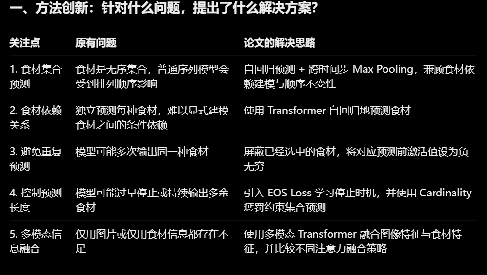

# 郝天乐调研记录

## **论文：** Food\-500 Cap: A Fine\-Grained Food Caption Benchmark for Evaluating Vision\-Language Models

**作者：** Zheng Ma et al\.

**发表会议：** ACM Multimedia 2023

**论文链接：** [https://arxiv\.org/abs/2308\.03151](https://arxiv.org/abs/2308.03151)

**代码与数据标注：** [https://github\.com/aaronma2020/Food500\-Cap](https://github.com/aaronma2020/Food500-Cap)


## **论文：** **Inverse Cooking: Recipe Generation from Food Images（CVPR 2019）**

**（写的真的挺好的）**

**研究问题：** 如何从食物图像中预测食材集合，并进一步生成与图像相对应的菜名和烹饪步骤？重点解决食材之间的依赖关系建模，以及图像特征与食材语义如何共同指导食谱生成的问题。

**核心方法：**

1. 使用 ResNet\-50 提取图像特征。

2. 使用 Set Transformer 预测食材集合，通过自回归预测学习食材之间的依赖关系，并利用跨时间步最大池化减少对食材排列顺序的惩罚。

3. 使用多模态 Transformer 融合图像特征与食材特征，生成菜名和烹饪步骤。

4. 对比不同的图像与食材特征融合方式，验证两种模态共同参与生成的效果。

**数据与条件：** 使用 Recipe1M 数据集，包含食物图像、菜名、食材清单和烹饪步骤等信息。经过数据筛选与预处理后，食材词表包含 1,488 种食材。模型同时利用图像信息和食材语义信息完成食谱生成。

**主要实验结论：** Set Transformer 在测试集上取得 32\.11 的 IoU 和 48\.61 的 F1。完整模型的测试集困惑度（PPL）为 8\.51，优于仅使用图像的模型（9\.66）和仅使用食材的模型（8\.67）。人工评价中，模型生成的食谱与图片的匹配成功率为 55\.47%，高于检索基线的 48\.81%，但仍低于真实食谱的 80\.33%。

**方法局限：**

1. 食物图像无法唯一确定隐藏食材及真实烹饪过程，生成的食谱不一定等于原始制作方法。

2. 食材预测错误可能传递到后续生成模块，影响食谱内容。

3. PPL 和食材 Precision、Recall 不能全面衡量烹饪步骤的操作合理性，论文没有直接验证每一步操作的实际正确率。

4. 该方法主要关注食材集合与食谱生成，并未直接解决食材重量回归和营养成分估计问题。

**对 FoodLens 项目的启发：**

1. 任务一可以借鉴“先预测食材语义，再辅助文本生成”的思路，探索显式食材信息能否提高图像描述的准确性与细粒度程度。

2. 任务二可以借鉴多标签食材预测和食材依赖关系建模，但需要额外设计重量与营养数值预测模块。

3. 实验设计可以通过消融实验比较仅使用图像特征、仅使用食材信息以及融合两类信息的效果。

4. 需要关注中间食材预测的误差传递，避免错误的食材标签进一步影响最终输出。

**待验证问题：**

1. 在 FoodLens 任务一中，增加食材预测作为中间语义信息，是否比直接生成描述更有效？

2. 在仅使用 RGB 图像的条件下，食材识别与食材重量估计分别能达到怎样的效果？

3. 直接生成结构化 JSON 数值与采用独立回归头预测重量、营养成分，哪种方案的误差更低？

4. 如何设计**评价指标**，分别衡量食材识别准确性、文本描述质量和数值预测误差？




1\.模型既要学习图片中的视觉特征，也应该利用食材之间的共现关系，关注set transformer的思想。

2\.始终没有说预测步骤的准确率，而是从其他角度衡量， IoU、Precision、Recall、F1，ppl等

3\.食材预测阶段错误直接影响步骤预测，评判点可分开


## **论文：** Nutrition5k: Towards Automatic Nutritional Understanding of Generic Food（CVPR 2021）

**现有数据集的不足：**

1. 传统食物分类数据集主要提供菜品类别标签，无法支持细粒度营养预测。

2. 网络爬取的食谱图片虽然包含菜品、食材等语义信息，但通常缺少图片中实际食材的重量标注。

3. 让人工标注者根据图片估计食物重量，即使是专业营养师也难以保证准确性。

4. 缺乏同时包含真实食物图像、食材级重量、总重量和营养成分的综合数据集。

## 数据集构成（论文最重要的贡献）

**数据集名称：** Nutrition5k

**数据规模：**

- 5,006 份真实食物样本。

- 涉及 250 多种食材。

- 约 20,000 段侧面旋转视频。

- 约 3,500 份俯视 RGB\-D 数据。

- 每份食物平均包含 5\.7 种食材，最多包含 35 种。

**数据模态：**

1. RGB 视频：四个侧面摄像机拍摄食物旋转过程，获取不同角度的外观信息。

2. RGB\-D 图像：通过俯视深度摄像机获取食物颜色信息和空间深度信息。

3. 重量数据：记录每次添加食物后的增量重量。

4. 食材信息：记录食材名称及其对应的重量。

5. 营养信息：记录整盘食物的总重量、热量、蛋白质、脂肪和碳水化合物。

**标注层级：**

- 食材级：食材名称、食材重量及其营养贡献。

- 菜品级：整盘食物的总重量、总热量及三大宏量营养素。

## 对 FoodLens 项目的启发

1. **数据集构成方面**

可以参考 Nutrition5k 建立多层次标注体系：

- 图像层：食物 RGB 图片。

- 食材层：食材名称、食材重量。

- 菜品层：总重量、热量、蛋白质、脂肪和碳水化合物。

不能只收集图片与菜品名称，否则难以支持细粒度食材和营养数值预测。

2. **数据采集方面**

可以借鉴增量式采集思路，针对一份混合食物，逐项记录食材名称、添加重量和最终整盘重量。初期不一定需要复刻昂贵的机器人采集设备，可以采用普通 RGB 摄像头、电子秤和人工记录相结合的低成本方案。

3. **营养标注方面**

可以借鉴食谱配方与标准营养数据库结合的方式，通过食材重量和单位重量营养值计算整盘营养总量，避免让标注人员仅凭图片主观估计热量。

4. **数据划分方面**

如果同一道菜、同一餐盘或同一增量采集过程产生多个样本，应当按餐盘或采集组划分训练集和测试集，避免数据泄漏。

5. **数据质量方面**

除了记录食材名称和重量，还应尽可能记录烹饪方式、用油量、酱料及隐藏食材等信息，降低图像外观相似但营养组成不同造成的误差。


## **论文：** Show and Tell: A Neural Image Caption Generator（CVPR 2015）

**作者：** Oriol Vinyals et al\.

**研究问题：** 传统图像描述方法主要依赖人工设计的视觉特征、模板或检索机制，难以灵活生成自然语言描述。作者希望建立一个端到端的神经网络模型，直接根据图像生成完整的自然语言句子。

**核心方法：**


1. **CNN Encoder：** 使用预训练 CNN 提取图像特征，将图像编码为固定维度的视觉表示。

2. **LSTM Decoder：** 使用 LSTM 作为语言生成器，根据图像特征和之前生成的单词，逐步预测下一个单词。

3. **图像与文本融合：** 将图像特征作为 LSTM 的初始输入，之后通过词嵌入将前一个单词传递给 LSTM，利用隐藏状态保留图像和语言上下文信息。

4. **自回归生成：** 将句子概率分解为每个时间步的条件概率，通过最大化真实描述的似然进行训练，并使用 EOS 标记控制句子结束。

**方法创新与工程优化：**

1. 将 CNN 图像编码与 LSTM 序列生成结合，形成统一的图像描述生成框架 NIC（Neural Image Caption）。

2. 图像特征只在初始时间步输入一次，而不是在每个生成时间步重复输入。作者发现重复输入图像特征反而容易引入噪声并增加过拟合。

3. 使用 ImageNet 预训练 CNN 提高视觉特征的泛化能力；实验中冻结 CNN 主体参数，避免直接调整其权重带来的性能下降。

4. 使用 Dropout 和模型集成缓解过拟合；采用 Beam Search 提高句子生成效果。

**数据与条件：** 在 PASCAL VOC 2008、Flickr8k、Flickr30k、MS COCO 和 SBU 五个数据集上进行实验。除 SBU 外，大部分数据集为每张图片提供五条人工描述。SBU 使用图片上传者提供的描述，标注噪声相对较大。

**主要实验结论：** 在 MS COCO 开发集上，BLEU\-4 达到 27\.7，METEOR 为 23\.7，CIDEr 为 85\.5。在 PASCAL、Flickr30k、Flickr8k 和 SBU 上，BLEU\-1 分别达到 59、66、63 和 28，优于论文对比的此前方法。实验还表明，使用 Beam Search（beam size=20）比 Greedy Search 平均高约 2 个 BLEU 分数。

**方法局限：**

1. 将整张图片压缩成固定的全局视觉特征，缺乏对具体图像区域的动态关注能力。

2. 视觉特征可能丢失细粒度局部信息，难以准确描述多个相似物体及其细节。

3. 自回归生成依赖前面已经生成的词，前序预测错误可能影响后续生成。

4. 模型对训练数据规模和标注质量较为敏感，跨数据集迁移时容易受到领域差异影响。

**对 FoodLens 项目的启发：**

1. 为模型 A（ResNet\-18 \+ GRU）提供经典 CNN\-RNN Encoder\-Decoder 架构参考。

2. 可以借鉴图像特征与词嵌入融合的方式，将视觉信息转化为语言生成条件。

3. 可以比较 LSTM 与 GRU 在模型参数量、训练效率和描述质量上的差异。

4. 可以通过消融实验比较图像特征在初始时间步输入与每个时间步重复输入的效果。

5. 其全局图像特征存在细粒度信息不足的问题，为后续引入 Attention 和 Grid Features 提供了研究动机。


## **论文：** Show, Attend and Tell: Neural Image Caption Generation with Visual Attention（ICML 2015）

之前的CNN把所有向量融合成一个全局了，这里是给最后一层输出的196个向量加上注意力机制

**作者：** Kelvin Xu et al\.

**研究问题：** Show and Tell 将整张图片压缩为一个全局特征向量，生成每个单词时使用相同的视觉信息，难以充分利用局部细节。本文通过引入视觉注意力机制，使模型能够在生成不同单词时动态关注图像的不同区域。

**模型架构：CNN Encoder \+ Attention \+ LSTM Decoder**

1. **CNN Encoder：** 使用 ImageNet 预训练的 VGG\-19 提取空间特征，得到 \(14\\times14\\times512\) 的特征图，展开为 \(196\\times512\) 的视觉特征矩阵，每个位置对应一个图像区域的特征。

2. **Attention Mechanism：** 根据当前 LSTM 隐藏状态与各区域视觉特征计算注意力得分，经 Softmax 得到区域权重，再加权求和得到当前时间步的视觉上下文向量。

3. **LSTM Decoder：** 将当前视觉上下文向量、前一个单词的词嵌入和历史隐藏状态共同输入 LSTM，预测下一个单词，重复生成直至 EOS。

**核心方法创新：**

1. **Soft Attention（软注意力）：** 对所有图像区域进行加权求和，形成连续、可微的视觉上下文向量，可直接通过标准反向传播训练。

2. **Hard Attention（硬注意力）：** 根据注意力概率分布随机采样一个图像区域，仅使用被选中区域的特征；通过 REINFORCE 和随机梯度估计进行训练。

3. **Doubly Stochastic Attention（双随机注意力正则化）：** 约束各区域在整个句子生成过程中的累计注意力，一个区域所有时间步累计权重为1，减少模型长期忽略部分图像区域的问题。

感觉这个机制有局限，会导致后面生成需要再关注这个区域的时候反而没办法关注,虽然只是增加了一个惩罚项，需要控制正则化参数。可以设置消融实验对比。

```LaTeX
\[ \sum_{i=1}^{L}\alpha_{t,i}=1 \]
```

4. **Attention Gate（注意力门控）：** 引入动态门控系数 \(\\beta\_t\)，控制当前时间步视觉信息的使用程度，使模型能够调节视觉信息与语言上下文的相对作用。

**训练与工程优化：**

- 使用 VGG\-19 的 ImageNet 预训练特征，不进行 CNN 微调。

- 根据句子长度组织 Mini\-batch，减少 Padding 带来的无效计算。

- 使用 Dropout 和 Early Stopping 缓解过拟合，并根据验证集 BLEU 选择模型。

- Hard Attention 使用移动平均基线降低 REINFORCE 梯度估计的方差。

**数据与实验结论：** 在 Flickr8k、Flickr30k 和 MS COCO 数据集上进行实验，每张图片通常有五条人工描述。使用 BLEU 和 METEOR 评价生成效果。实验表明，Attention 模型在多个数据集上取得了较好的图像描述结果；Hard Attention 与 Soft Attention 各有优势，并非所有评价指标上都由同一种方法占优。论文还通过注意力热图展示了生成单词与图像区域之间的对应关系。

**方法局限：**

1. 14×14 的空间特征仍然存在分辨率限制，可能难以捕捉特别细小的食物属性。

2. Attention 只能选择视觉区域，不能保证区域内物体或食材识别正确。

3. Hard Attention 需要随机采样和强化学习式梯度估计，训练复杂度较高。

4. 模型仍然依赖 LSTM 自回归生成，存在序列生成效率和长期依赖方面的局限。

**对 FoodLens 项目的启发：**

1. 任务一可以借鉴空间特征与动态注意力机制，使模型在生成不同食材名称、颜色和形状描述时利用不同局部视觉信息。

2. 可以将全局特征模型与空间特征模型进行对比，验证保留局部信息是否有助于细粒度食物描述。

3. Attention 可视化可以辅助分析模型是否关注了正确的食材区域，但不能单独作为识别正确性的证据。

4. 为后续 Grid Features 与 Transformer 图像描述模型提供了技术基础。


